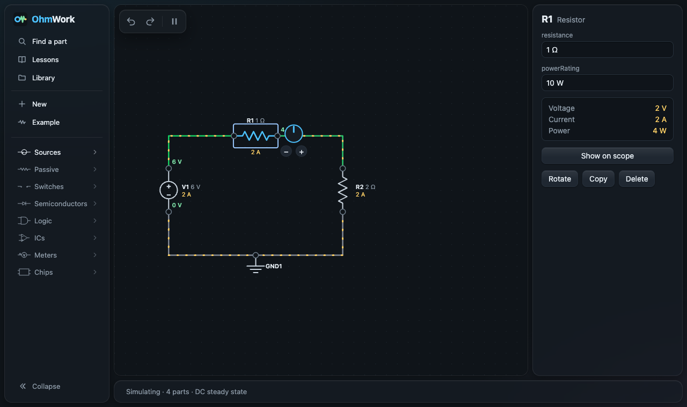

# OhmWork

**A free circuit simulator for learning electronics.** Place parts, wire them up and watch the current flow, follow
lessons that check your work, or build a circuit together with an AI agent.

**[Open it in your browser](https://ifeanyiotiwa-hub.github.io/ohmwork/)** ·
**[Download for macOS, Windows or Linux](https://github.com/ifeanyiotiwa-hub/ohmwork/releases/latest)** ·
**[How-to guides](docs/README.md)**

## What you can do
- **Build and simulate.** 73 parts: sources, resistors, capacitors, switches, diodes, LEDs, transistors, logic gates,
  flip-flops, op-amps, the 555 timer, displays, motors and meters. The circuit responds as you edit it, and current
  moves visibly through the wires.
- **See what every part is doing.** Turn a value on a dial, hover a wire for its voltage and current, and watch an
  overloaded part overheat and smoke.
- **Measure over time and frequency.** An oscilloscope (with trigger and X-Y mode) and a frequency-response view,
  checked against ngspice, the standard open-source circuit simulator.
- **Learn step by step.** Ten lessons, from lighting an LED to a 555 blinker and a low-pass filter. Each one checks
  that your circuit actually behaves as asked, not just that it looks right.
- **Work with an AI agent.** Claude or another agent reads the real circuit (every part, wire and reading, not a
  screenshot), builds and explains it, and tutors you while you both edit the same circuit live.
- **Build bigger circuits.** Net labels, buses, and your own reusable chips made from a selection.
- **Use it anywhere.** In the browser, installed as an app that works offline (iPhone and iPad too), or as a desktop
  app. No account needed; your circuits stay on your device.

## For students and teachers
- It's free, it needs no sign-up, and once installed it works with no internet.
- The lessons check the behaviour of the circuit: the LED must light, the filter must cut the high notes.
- An AI tutor gives one hint at a time and checks your circuit instead of handing you the answer.
- Circuits save as `.circuit.json` files, so a class can share, hand in and mark them.

Start with [Lessons and the tutor](docs/lessons.md).

## How it's built
| Part | What it is |
|---|---|
| Simulation engine | TypeScript: modified nodal analysis with Newton–Raphson for diodes and transistors, and digital logic stepped with the analog solve. Results checked against ngspice. |
| Web app | Angular 22 (signals, zoneless) drawing the circuit in SVG; time-based simulations run in a Web Worker. Installs as an offline app. |
| Desktop and Android | Tauri 2 around the same web app. |
| AI agent server | An MCP server with over two dozen tools (build, simulate, explain, check a lesson) and a live link, so the agent and the learner edit one circuit and can undo each other's changes. |
| Quality | Over 800 unit tests and about 90 browser tests; known-answer circuits for the engine; 50 recorded design decisions. |
| Releases | GitHub Actions publish the web app on every push and build installers for macOS (both chips), Windows and Linux from a version tag. |

The plan, the architecture and every decision with its reasons are in [`projectKnowledge/`](projectKnowledge/).

## About the builder
I'm Ifeanyichukwu Otiwa. I built OhmWork by directing AI coding agents, and I own the product end to end: I set what
it is and who it's for, broke it into deliverables with acceptance criteria, decided or approved each design choice,
reviewed and tested what the agents produced, and shipped it as a live web app, desktop installers for three systems
and a public release.

The agents wrote much of the code, and the way we worked is in the open: [`projectKnowledge/`](projectKnowledge/)
holds the vision, the deliverables, the decision log and the handover notes each agent session starts from.

Get in touch through [GitHub](https://github.com/ifeanyiotiwa-hub).

## Licence and credits
GPL-2.0-or-later. Some of the simulation maths is ported from [CircuitJS1](https://github.com/pfalstad/circuitjs1) by
Paul Falstad, which is under the same licence.
